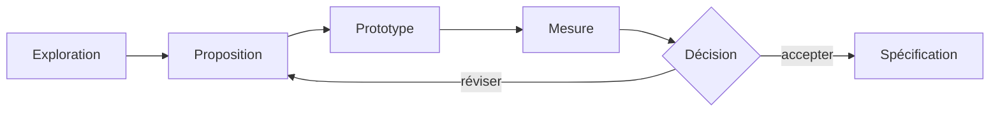

# Contribuer à Metaverse_007

> English speakers: see [Contributing (English)](#contributing-english) at the end of this page.

## Règles essentielles

1. Ne pas présenter une hypothèse comme une technologie disponible.
2. Ne pas renommer un concept existant sans expliquer la différence sémantique réelle.
3. Toute primitive de langage proposée doit préciser sa syntaxe, ses règles de typage, sa sémantique d'exécution, ses erreurs et au moins un exemple.
4. Toute affirmation de performance doit être accompagnée d'un benchmark reproductible.
5. Toute décision importante doit référencer une fiche `HC-xxx` et une entrée `ADR-xxx`.
6. Les documents officiels sont écrits en français ; les termes techniques anglais peuvent être conservés lorsqu'ils sont standards.

## Cycle d'une idée

## Ajouter une discussion

1. Copier [le modèle de fiche](templates/DISCUSSION_TEMPLATE.md).
2. Attribuer le prochain identifiant `HC-xxx`.
3. Ajouter les URL de partage autorisées.
4. Résumer les conclusions sans effacer les désaccords.
5. Relier les projets et décisions concernés.
6. Mettre à jour [l'index](docs/02-gouvernance/DISCUSSIONS.md).

## Ajouter une décision

1. Copier [le modèle ADR](templates/DECISION_TEMPLATE.md).
2. Attribuer le prochain identifiant `ADR-xxx`.
3. Lier les discussions qui justifient la décision.
4. Définir les conséquences et critères de réexamen.
5. Mettre à jour [le registre](docs/02-gouvernance/DECISIONS.md).

## Travail avec une IA

Une IA doit commencer par lire le `README`, le registre des décisions et les documents directement concernés. Elle peut critiquer une décision, mais ne doit pas modifier son statut sans validation explicite du responsable du projet.

## Lancer les essais du moteur, et proposer une pull request

Le moteur est dans [`moteur/`](moteur/README.md) : du Rust compilé en WebAssembly, un serveur (`holo serve`) et des outils en Node.js. Prérequis : Rust (stable) avec la cible `wasm32-unknown-unknown`, `wasm-bindgen-cli` 0.2.100 (la version de `moteur/Cargo.toml`), Node.js 22, et Chrome pour les essais dans un navigateur.

1. **Construire**, depuis `moteur/` : `cargo build --release --target wasm32-unknown-unknown`, puis `wasm-bindgen --target web --no-typescript --out-dir web/pkg target/wasm32-unknown-unknown/release/holo_engine.wasm` ; le moteur léger avec `CARGO_PROFILE_RELEASE_OPT_LEVEL=z cargo build --release --target wasm32-unknown-unknown --no-default-features --target-dir target/light` et la même commande `wasm-bindgen` vers `web/pkg-light` ; l'outil en ligne de commande avec `cargo build --release --bin holo`. Sur Windows, `.\outils\build.ps1` fait tout cela.
2. **Les essais du moteur** : `cargo test --release --locked`, puis `cargo test`. Ils relisent toutes les leçons et tous les exemples du guide : une leçon ou un exemple cassé fait échouer la suite.
3. **Les essais dans Chrome** : `node outils/browser-tests.mjs` (Chrome sans fenêtre ; un seul essai avec `node outils/browser-tests.mjs "un mot de son titre"`). L'audit d'accessibilité des parcours demande `axe-core` : `npm install --no-save axe-core@4.10.3` dans `moteur/`, comme le fait GitHub.
4. **Une pull request** : une branche par changement, jamais d'envoi direct sur `main` (elle est protégée). Un ajout au langage apporte, dans la même PR : sa leçon dans `exemples/lecons/` (une notion par leçon), un essai dans Chrome qui sait échouer, le guide ([`docs/01-holocode/GUIDE.md`](docs/01-holocode/GUIDE.md)), [`NOMS.md`](docs/01-holocode/NOMS.md), [`DECISIONS.md`](docs/02-gouvernance/DECISIONS.md) avec sa fiche `ADR-xxx`, et une entrée en haut du [journal](docs/06-journal/JOURNAL.md). Le code est en anglais, les commentaires et les textes en français (`ADR-060`). La description de la PR donne les résultats exacts des commandes ; GitHub rejoue les trois suites ; on ne fusionne que ce qui est vert, et seul le responsable du projet, ou une session Claude qu'il désigne, fusionne.
5. **Pour commencer** : les issues [`good first issue`](https://github.com/yocthanmabeka/Metaverse_007/labels/good%20first%20issue), et la file de travail décrite dans [`AGENTS.md`](AGENTS.md) (« La file de travail ») : une tâche par issue, prise par une étiquette et un commentaire.

---

## Contributing (English)

Official documents are written in French; this section summarises them for English-speaking contributors.

**Essential rules.** Do not present a hypothesis as an available technology. Do not rename an existing concept without explaining the real semantic difference. A proposed language primitive states its syntax, typing rules, execution semantics, errors and at least one example. Any performance claim comes with a reproducible benchmark. Any important decision references an `HC-xxx` discussion and an `ADR-xxx` record. Code is written in English, comments and user-facing texts in French (`ADR-060`). An AI reads the `README`, the decision register and the documents concerned before writing; it may criticise a decision, but never changes its status without the maintainer's explicit validation.

**Run the engine's tests.** The engine lives in [`moteur/`](moteur/README.md): Rust compiled to WebAssembly, a server (`holo serve`) and Node.js tools. Prerequisites: Rust (stable) with the `wasm32-unknown-unknown` target, `wasm-bindgen-cli` 0.2.100 (the version in `moteur/Cargo.toml`), Node.js 22, and Chrome for the browser tests.

1. Build, from `moteur/`: `cargo build --release --target wasm32-unknown-unknown`, then `wasm-bindgen --target web --no-typescript --out-dir web/pkg target/wasm32-unknown-unknown/release/holo_engine.wasm`; the light engine with `CARGO_PROFILE_RELEASE_OPT_LEVEL=z cargo build --release --target wasm32-unknown-unknown --no-default-features --target-dir target/light` and the same `wasm-bindgen` command into `web/pkg-light`; the command-line tool with `cargo build --release --bin holo`. On Windows, `.\outils\build.ps1` does all of it.
2. Engine tests: `cargo test --release --locked`, then `cargo test`. They re-read every lesson and every example of the guide: a broken lesson or example fails the suite.
3. Browser tests: `node outils/browser-tests.mjs` (headless Chrome; a single test with `node outils/browser-tests.mjs "a word of its title"`). The accessibility audit needs `axe-core`: `npm install --no-save axe-core@4.10.3` in `moteur/`, as GitHub does.

**Propose a pull request.** One branch per change; never push to `main` (it is protected). An addition to the language brings, in the same PR: its lesson in `exemples/lecons/` (one notion per lesson), a Chrome test that can fail, the guide ([`docs/01-holocode/GUIDE.md`](docs/01-holocode/GUIDE.md)), [`NOMS.md`](docs/01-holocode/NOMS.md), [`DECISIONS.md`](docs/02-gouvernance/DECISIONS.md) with its `ADR-xxx` record, and an entry at the top of the [journal](docs/06-journal/JOURNAL.md). The PR description gives the exact command results; GitHub replays the three suites; only green work is merged, and only the maintainer, or a Claude session he designates, merges. Start with the [`good first issue`](https://github.com/yocthanmabeka/Metaverse_007/labels/good%20first%20issue) label and the work queue described in [`AGENTS.md`](AGENTS.md) (« La file de travail »): one task per issue, claimed with a label and a comment.
