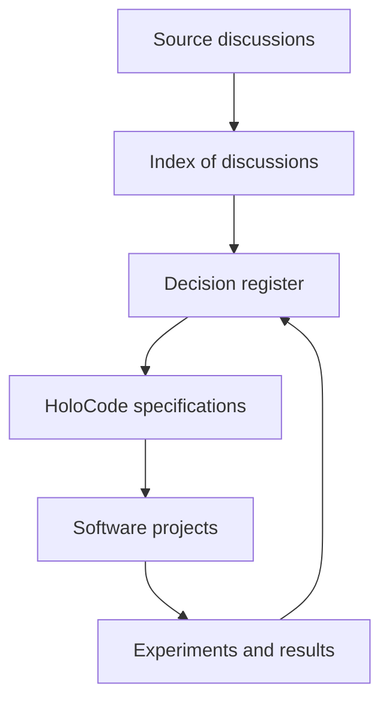

# Metaverse_007

> 🇫🇷 This is the English translation of [README.md](README.md), the reference version, which is in French. When the two differ, the French one is right.

Public repository, under the [MIT licence](LICENSE), for the research, design and transmission of the **Holoverse** project and its language, **HoloCode**. The GitHub repository has been called `yocthanmabeka/Metaverse_007` since 2026-10-12 (its former names, `Metaverse` then `Oyo-Oyo`, redirect).

## Quick start

HoloCode is a language in which a beginner writes a complete website, and later a world, in one `.holo` file of named blocks (`Page`, `H1`, `Button`, `On`…), without writing HTML, CSS or JavaScript. The engine (Rust compiled to WebAssembly) renders the page, checks everything, and refuses a fault with the right word. Everything runs on the author's own machine: no mandatory provider.

Prerequisites: [Rust](https://rustup.rs) (stable) with the `wasm32-unknown-unknown` target, [wasm-bindgen-cli 0.2.100](https://github.com/rustwasm/wasm-bindgen/releases/tag/0.2.100), [Node.js](https://nodejs.org) 22, and Chrome (for the browser tests).

```bash
git clone https://github.com/yocthanmabeka/Metaverse_007.git
cd Metaverse_007/moteur

# 1. The engine's tests: every lesson and every example of the guide is checked
cargo test --release --locked

# 2. Build the engine for the browser (full and light), and the command-line tool
cargo build --release --target wasm32-unknown-unknown
wasm-bindgen --target web --no-typescript --out-dir web/pkg target/wasm32-unknown-unknown/release/holo_engine.wasm
CARGO_PROFILE_RELEASE_OPT_LEVEL=z cargo build --release --target wasm32-unknown-unknown --no-default-features --target-dir target/light
wasm-bindgen --target web --no-typescript --out-dir web/pkg-light target/light/wasm32-unknown-unknown/release/holo_engine.wasm
cargo build --release --bin holo
#    On Windows, .\outils\build.ps1 does all of this.

# 3. Serve the examples, then open a lesson in your browser
node outils/server.mjs
#    http://localhost:8080/exemples/lecons/01-page.holo

# 4. The browser tests (headless Chrome)
node outils/browser-tests.mjs
```

Then read the author's guide, [docs/01-holocode/GUIDE.md](docs/01-holocode/GUIDE.md) (in French), and the 141 lessons in [exemples/lecons/](exemples/lecons/README.md), one notion each. The current state of the project is kept in [AGENTS.md](AGENTS.md) (section « État »); how to contribute, in [CONTRIBUTING.md](CONTRIBUTING.md) (French and English).

## Three levels of information

This repository links three levels of information:

1. the **discussions**, which keep the reasoning and the explorations;
2. the **decisions**, which say what was actually retained;
3. the **projects**, which turn decisions into software, experiments and prototypes.

> Conversations are for thinking. Documents are for transmitting. Specifications are for building.

## Vision

Holoverse studies the creation of a computing infrastructure for interactive, spatial, persistent and potentially distributed digital worlds. HoloCode is the language envisaged to describe these worlds through native abstractions: worlds, spaces, entities, relations, laws, time and phenomena.

The project starts on today's hardware. Spatial processors, holographic interfaces and new hardware architectures remain long-term research directions, never capabilities assumed to be available.

## Map of the repository



## Start here

| Need | Document |
|---|---|
| Understand the overall ambition | [Holoverse vision](docs/00-vision/VISION.md) |
| Understand the proposed paradigm | [Holoscenic paradigm](docs/01-holocode/PARADIGME-HOLOSCENIQUE.md) |
| Understand the technical chain | [HoloCode architecture](docs/01-holocode/ARCHITECTURE.md) |
| Find the source conversations | [Index of discussions](docs/02-gouvernance/DISCUSSIONS.md) |
| Know what is decided or still hypothetical | [Decision register](docs/02-gouvernance/DECISIONS.md) |
| Make several AIs collaborate without losing coherence | [AI collaboration protocol](docs/02-gouvernance/PROTOCOLE-IA.md) |
| See the planned sub-projects | [Project map](docs/03-projets/PROJETS.md) |
| Follow the stages of realisation | [Roadmap](docs/04-roadmap/ROADMAP.md) |
| Contribute properly | [Contribution guide](CONTRIBUTING.md) |
| Know what happened, step by step | [Journal](docs/06-journal/JOURNAL.md) |
| Plug an AI or a tool into the project | [AGENTS.md](AGENTS.md) |
| See the first executable proof | [Big Bang sprint](moteur/README.md) |
| Know what an engine must do | [Conformance suite](experiments/conformite-v0.1/README.md) |
| Read the AIs' proposals | [Register of proposals](proposals/README.md) |

## Short roadmap, and the 2030 goal

1. **The web, done** (2026-10-10): HoloCode does what HTML, CSS and JavaScript do for a website, without the author writing any of the three. 141 lessons; of the 135 web capabilities in the [big table](docs/01-holocode/TABLEAU-WEB.md), 121 are covered, the others are refused on purpose (`div`, `script`, the CSS cascade, placing by hand…) or reserved for 3D.
2. **3D and multiplayer, by 2030**: the same `.holo` page seen in depth; solid objects and realistic light, in quality tiers ([`PLAN-3D.md`](docs/04-roadmap/PLAN-3D.md)); then the presence of others in a world, the author's server staying at home.
3. **Beyond 2030**: a browser of the project's own, then hardware (spatial processors, holographic interfaces), as research directions, never as capabilities assumed to be available.

**2030 goal**: a `.holo` file is both a website and a world, readable flat or in depth on any phone, in every language, with no mandatory provider. The detail, step by step: [Roadmap](docs/04-roadmap/ROADMAP.md).

## Documentary statuses

Every important proposal carries one of these statuses:

| Status | Meaning |
|---|---|
| `EXPLORATION` | An idea to examine, without commitment. |
| `PROPOSITION` | A solution precise enough to be criticised or prototyped. |
| `EXPÉRIMENTATION` | A hypothesis currently under test. |
| `ACCEPTÉ` | An official decision of the project. |
| `REJETÉ` | An option examined then set aside, with its justification kept. |
| `REMPLACÉ` | A former decision superseded by a more recent one. |

## Traceability principle

Every important architectural decision states:

- its source discussion(s) (`HC-xxx`);
- the problem addressed;
- the alternatives studied;
- its status;
- the projects affected;
- the criteria that would confirm or replace it.

Conversation URLs that are not yet available are marked `À AJOUTER` (to be added). They must never be invented.

## Current state

> **Update of 2026-10-12.** The real state of the project is kept in [`AGENTS.md`](AGENTS.md) (section « État ») and in the [journal](docs/06-journal/JOURNAL.md): the engine in Rust and WebAssembly ([`moteur/`](moteur/README.md)), the `holo serve` server, 141 lessons, the whole of the web. The text below describes the first prototype, in Python, from September 2026.

The repository contains **Proposition code by GPT5.6 — HoloCode v0.1**, a first executable proof able to define a minimal world, instantiate entities, evaluate a spatial relation and trigger an observable phenomenon.

### Run the first scene

Prerequisite: Python 3.11 or newer.

```bash
cd proposals/GPT5.6/holocode-v0.1
python -m holocode examples/automatic_door.holo --ticks 2
```

Run the tests:

```bash
python -m unittest discover -s tests -v
```

The prototype, its syntax and its limits are described in the [HoloCode v0.1 specification](docs/01-holocode/SPECIFICATION-V0.1.md).

Experimental implementations are filed by author in the [register of code proposals](proposals/README.md). Every change must remain visible on GitHub, following the [synchronisation policy](GITHUB-SYNC-POLICY.md).

## Licence and conduct

The project has been under the [MIT licence](LICENSE) since 2026-10-12 (decision of Yocthan Mabeka, [`ADR-122`](docs/02-gouvernance/adr/ADR-122-licence-mit-et-nom-metaverse-007.md); before that, "all rights reserved"). Fonts keep their own licence: Carlito (`exemples/lecons/carlito.woff2`, [SIL Open Font License 1.1](exemples/lecons/carlito-LICENCE.txt)) and the engine's fonts (`moteur/web/fonts/`, each with its `LICENSE.txt`). The code of conduct is the [Contributor Covenant 2.1](CODE_OF_CONDUCT.md).
