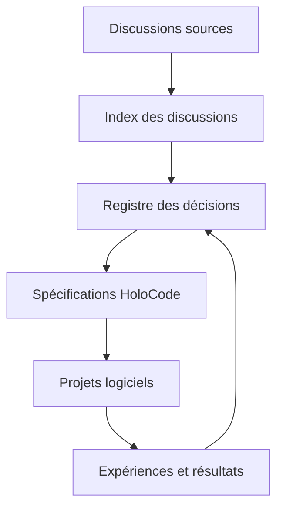

# Metaverse_007

> 🇬🇧 **English readers:** the whole of this page is translated in [README.en.md](README.en.md). The quick start below is in English.

## Quick start (English)

HoloCode is a language in which a beginner writes a complete website, and later a world, in one `.holo` file of named blocks (`Page`, `H1`, `Button`, `On`…), without writing HTML, CSS or JavaScript. The engine (Rust compiled to WebAssembly) renders the page, checks everything, and refuses a fault with the right word. Everything runs on the author's own machine: no mandatory provider.

Prerequisites: [Rust](https://rustup.rs) (stable) with the `wasm32-unknown-unknown` target, [wasm-bindgen-cli 0.2.100](https://github.com/rustwasm/wasm-bindgen/releases/tag/0.2.100), [Node.js](https://nodejs.org) 22, and Chrome (for the browser tests).

```bash
git clone https://github.com/yocthanmabeka/Metaverse_007.git
cd Metaverse_007/moteur

# 1. The engine's tests: every lesson and every example of the guide is checked
cargo test --release --locked

# 2. Build the engine for the browser (full and light), and the command-line tool
cargo build --release --target wasm32-unknown-unknown
wasm-bindgen --target web --no-typescript --out-dir web/pkg target/wasm32-unknown-unknown/release/holo_engine.wasm
CARGO_PROFILE_RELEASE_OPT_LEVEL=z cargo build --release --target wasm32-unknown-unknown --no-default-features --target-dir target/light
wasm-bindgen --target web --no-typescript --out-dir web/pkg-light target/light/wasm32-unknown-unknown/release/holo_engine.wasm
cargo build --release --bin holo
#    On Windows, .\outils\build.ps1 does all of this.

# 3. Serve the examples, then open a lesson in your browser
node outils/server.mjs
#    http://localhost:8080/exemples/lecons/01-page.holo

# 4. The browser tests (headless Chrome)
node outils/browser-tests.mjs
```

Then read the author's guide, [docs/01-holocode/GUIDE.md](docs/01-holocode/GUIDE.md) (in French), and the 141 lessons in [exemples/lecons/](exemples/lecons/README.md), one notion each. The current state of the project is kept in [AGENTS.md](AGENTS.md) (section « État »); how to contribute, in [CONTRIBUTING.md](CONTRIBUTING.md) (French and English).

---

Référentiel public, sous [licence MIT](LICENSE), de recherche, de conception et de transmission du projet **Holoverse** et de son langage **HoloCode**. Le dépôt GitHub s'appelle `yocthanmabeka/Metaverse_007` depuis le 2026-10-12 (ses anciens noms, `Metaverse` puis `Oyo-Oyo`, redirigent).

Ce dépôt relie trois niveaux d'information :

1. les **discussions**, qui conservent le raisonnement et les explorations ;
2. les **décisions**, qui indiquent ce qui a réellement été retenu ;
3. les **projets**, qui transforment les décisions en logiciels, expériences et prototypes.

> Les conversations servent à réfléchir. Les documents servent à transmettre. Les spécifications servent à construire.

## Vision

Holoverse étudie la création d'une infrastructure informatique pour des mondes numériques interactifs, spatiaux, persistants et potentiellement distribués. HoloCode est le langage envisagé pour décrire ces mondes à travers des abstractions natives : mondes, espaces, entités, relations, lois, temps et phénomènes.

Le projet commence sur le matériel actuel. Les processeurs spatiaux, interfaces holographiques et nouvelles architectures matérielles restent des axes de recherche à long terme, jamais des capacités supposées acquises.

## Carte du référentiel



## Commencer ici

| Besoin | Document |
|---|---|
| Comprendre l'ambition générale | [Vision de Holoverse](docs/00-vision/VISION.md) |
| Comprendre le paradigme proposé | [Paradigme holoscénique](docs/01-holocode/PARADIGME-HOLOSCENIQUE.md) |
| Comprendre la chaîne technique | [Architecture de HoloCode](docs/01-holocode/ARCHITECTURE.md) |
| Retrouver les conversations sources | [Index des discussions](docs/02-gouvernance/DISCUSSIONS.md) |
| Savoir ce qui est décidé ou encore hypothétique | [Registre des décisions](docs/02-gouvernance/DECISIONS.md) |
| Faire collaborer plusieurs IA sans perdre la cohérence | [Protocole de collaboration IA](docs/02-gouvernance/PROTOCOLE-IA.md) |
| Voir les sous-projets prévus | [Carte des projets](docs/03-projets/PROJETS.md) |
| Suivre les étapes de réalisation | [Feuille de route](docs/04-roadmap/ROADMAP.md) |
| Contribuer correctement | [Guide de contribution](CONTRIBUTING.md) |
| Savoir ce qui s'est passé, étape par étape | [Journal d'évolution](docs/06-journal/JOURNAL.md) |
| Brancher une IA ou un outil sur le projet | [AGENTS.md](AGENTS.md) |
| Voir la première preuve exécutable | [Sprint Big Bang](moteur/README.md) |
| Savoir ce qu'un moteur doit faire | [Suite de conformité](experiments/conformite-v0.1/README.md) |
| Lire les propositions des IA | [Registre des propositions](proposals/README.md) |

## Feuille de route courte, et l'objectif 2030

1. **Le web, fini** (2026-10-10) : HoloCode fait ce que HTML, CSS et JavaScript font pour un site, sans que l'auteur écrive l'un des trois. 141 leçons ; sur les 135 éléments du web du [grand tableau](docs/01-holocode/TABLEAU-WEB.md), 121 sont couverts, les autres sont refusés exprès (`div`, `script`, la cascade du CSS, placer à la main…) ou réservés à la 3D.
2. **La 3D et le jeu à plusieurs, d'ici 2030** : la même page `.holo` vue en profondeur ; des objets pleins et une lumière réalistes, par paliers de qualité ([`PLAN-3D.md`](docs/04-roadmap/PLAN-3D.md)) ; puis la présence des autres dans un monde, le serveur de l'auteur restant chez lui.
3. **Au-delà de 2030** : un navigateur propre au projet, puis le matériel (processeurs spatiaux, interfaces holographiques), comme axes de recherche, jamais comme capacités supposées acquises.

**Objectif 2030** : un fichier `.holo` est à la fois un site et un monde, lisible à plat ou en profondeur sur n'importe quel téléphone, dans toutes les langues, sans prestataire obligatoire. Le détail, étape par étape : [Feuille de route](docs/04-roadmap/ROADMAP.md).

## Statuts documentaires

Chaque proposition importante doit porter l'un de ces statuts :

| Statut | Signification |
|---|---|
| `EXPLORATION` | Idée à examiner, sans engagement. |
| `PROPOSITION` | Solution assez précise pour être critiquée ou prototypée. |
| `EXPÉRIMENTATION` | Hypothèse actuellement testée. |
| `ACCEPTÉ` | Décision officielle du projet. |
| `REJETÉ` | Option examinée puis écartée, avec justification conservée. |
| `REMPLACÉ` | Ancienne décision supplantée par une décision plus récente. |

## Principe de traçabilité

Toute décision architecturale importante doit indiquer :

- la ou les discussions sources (`HC-xxx`) ;
- le problème traité ;
- les alternatives étudiées ;
- son statut ;
- les projets affectés ;
- les critères qui permettraient de la confirmer ou de la remplacer.

Les URL de conversations qui ne sont pas encore disponibles sont marquées `À AJOUTER`. Elles ne doivent jamais être inventées.

## État actuel

> **Mise à jour du 2026-10-12.** L'état réel du projet est tenu dans [`AGENTS.md`](AGENTS.md) (section « État ») et dans le [journal](docs/06-journal/JOURNAL.md) : le moteur en Rust et WebAssembly ([`moteur/`](moteur/README.md)), le serveur `holo serve`, 141 leçons, le web entier. Le texte ci-dessous décrit le premier prototype, en Python, de septembre 2026.

Le dépôt contient maintenant **Proposition code by GPT5.6 — HoloCode v0.1**, une première preuve exécutable capable de définir un monde minimal, d'instancier des entités, d'évaluer une relation spatiale et de déclencher un phénomène observable.

### Exécuter la première scène

Prérequis : Python 3.11 ou plus récent.

```bash
cd proposals/GPT5.6/holocode-v0.1
python -m holocode examples/automatic_door.holo --ticks 2
```

Lancer les tests :

```bash
python -m unittest discover -s tests -v
```

Le prototype, sa syntaxe et ses limites sont décrits dans la [spécification HoloCode v0.1](docs/01-holocode/SPECIFICATION-V0.1.md).

Les implémentations expérimentales sont classées par auteur dans le [registre des propositions de code](proposals/README.md). Toute modification doit rester visible sur GitHub selon la [politique de synchronisation](GITHUB-SYNC-POLICY.md).

## Licence et conduite

Le projet est sous [licence MIT](LICENSE) depuis le 2026-10-12 (décision de Yocthan Mabeka, [`ADR-122`](docs/02-gouvernance/adr/ADR-122-licence-mit-et-nom-metaverse-007.md) ; auparavant « tous droits réservés »). Les polices gardent leur propre licence : Carlito (`exemples/lecons/carlito.woff2`, [SIL Open Font License 1.1](exemples/lecons/carlito-LICENCE.txt)) et les polices du moteur (`moteur/web/fonts/`, chacune avec son `LICENSE.txt`). Le code de conduite est le [Contributor Covenant 2.1](CODE_OF_CONDUCT.md).
